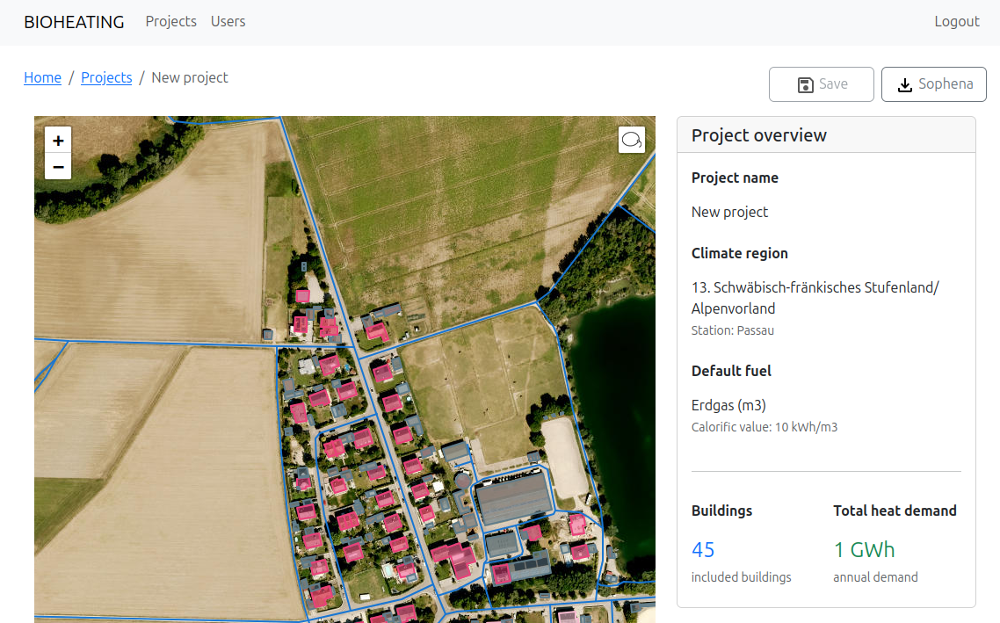

# The BioHeating Tool

This is the server application developed in the [BIOHEATING](https://biogas.fnr.de/projektfoerderung/ausgewaehlte-projekte/projekte/bioheating-tool-fuer-standortspezifische-waermekonzepte) project. It can be used to predict the heat demand for a set of buildings and for drafting a local heat net. A project created with this tool can be then exported to [Sophena](https://github.com/GreenDelta/Sophena) and further edited there. It has the following features (still under development):

+ CityGML import for building data
+ OSM import for street data
+ 1st model for heat demand predictions
+ UI with an interactive map for editing
+ Calculating and exporting the heat net layout




## Running from source

First, you need to create a Postgres database with the [database schema](./server/schema.sql) and settings as defined in the [application.properties](./server/src/main/resources/application.properties).

The server also needs a data directory that contains the trained prediction model. The path is set by the property `app.data-dir` or the environment variable `APP_DATA_DIR`. It defaults to `./app`, relative to the folder from which the server is started. When you start the server from the `server` folder, as shown below, the data directory is `server/app`:

```
server/app/
  model/      # demand-model.ubj, peak-model.ubj, config.json
  uploads/    # temporary upload files, created automatically
```

The [model training](./server/model-training/README.md) writes the model files into `server/app/model`. The server does not start without them.

The back-end is a SpringBoot application and is located in the `server` folder. You can just run the `App` in your favourite IDE (with `server` as working directory) or from the command line:

```bash
cd server
mvn spring-boot:run
```

The user interface is built with TypeScript, React, and Webpack. The UI source code is located in the `ui/` directory:

```bash
cd ui
npm run dev
```

This runs `webpack watch` mode, which automatically rebuilds the UI when source files change and outputs the built files to `server/static/`.

For a production build:

```bash
cd ui
npm run build
```

This runs webpack in production mode and outputs the built files to `server/static/`.


## Scaling the server

Project imports, data updates, and network calculations can take from a few
seconds to several minutes. They run as background tasks on the server, and
the user interface asks the server every second whether a task is finished.
This section describes how these tasks use CPU and memory and how to configure
them.

### Concepts

* **Parallel tasks:** at most `app.tasks.max-parallel` tasks run at the same
  time. Further tasks wait in a queue and start in the order in which they
  were created. In the user interface, a waiting task looks like a running
  task.
* **Queue capacity:** when `app.tasks.queue-capacity` tasks are already
  waiting, new tasks are rejected and the user gets the message that the
  server is busy. This limit only protects the server from running out of
  memory and should not be reached in normal operation.
* **Threads per calculation:** a network calculation uses its own threads
  (`app.calculation.threads`). Thus, the CPU load of parallel calculations is
  about _parallel tasks × threads per calculation_.
* **Task results:** a finished task keeps its result in memory until the user
  interface fetches it, at most for `app.tasks.retention-minutes`. If the user
  reloads the page, the task still runs to the end and saves its result in the
  database, so that the project or calculation result is available later.

### Parameters

The parameters are defined in the
[application.properties](./server/src/main/resources/application.properties)
and can be overwritten with environment variables (in Docker, in the
`environment` section of the
[docker-compose.yaml](./docker/docker-compose.yaml)):

| Property                      | Environment variable          | Default | Description                                    |
|-------------------------------|-------------------------------|---------|------------------------------------------------|
| `app.tasks.max-parallel`      | `APP_TASKS_MAX_PARALLEL`      | `2`     | the maximum number of tasks that run at once   |
| `app.tasks.queue-capacity`    | `APP_TASKS_QUEUE_CAPACITY`    | `100`   | the maximum number of waiting tasks            |
| `app.tasks.retention-minutes` | `APP_TASKS_RETENTION_MINUTES` | `30`    | how long the results of finished tasks are kept |
| `app.calculation.threads`     | `APP_CALCULATION_THREADS`     | `0`     | the threads of a single network calculation    |

For `app.calculation.threads`, the value `0` means that the number of threads
is derived from the available processors, so that two parallel calculations
can use the full CPU:

| Available processors | Threads per calculation |
|----------------------|-------------------------|
| 1 or 2               | 1                       |
| 3 to 5               | 2                       |
| 6 or more            | half of the processors  |

Note that in a Docker container, the server sees all processors of the host
unless a CPU limit is set for the container (`cpus` in the
`docker-compose.yaml`).

The memory of the server is set with the maximum heap size of the JVM (`-Xmx`,
in Docker in `JAVA_TOOL_OPTIONS`). In Docker, the memory limit of the
container (`mem_limit`) must be larger than the heap size, because the JVM
also needs memory outside of the heap.

### Logging

For each finished task, the server writes a log line with the task type, the
result, the time the task waited in the queue, and the time it ran:

```
Finished CALCULATION task 6e8a…: ok; waited 0 ms, ran 5312 ms
```

For more details, set the log level of the task package to `DEBUG`, either in
the `application.properties` or as environment variable:

```
logging.level.com.greendelta.bioheating.services.tasks=DEBUG
LOGGING_LEVEL_COM_GREENDELTA_BIOHEATING_SERVICES_TASKS=DEBUG
```

The server then also logs the number of running and waiting tasks when a task
starts, and the used heap memory after a task. The heap value is only a rough
indicator: it is a snapshot that also contains memory that is not yet freed by
the garbage collector.

### Sizing a server

To find a good configuration for a server, run representative projects (e.g.
with 100, 1000, and 5000 buildings) one after another and in parallel. Compare
the times in the log with the CPU and memory usage of the server (e.g. with
`docker stats`, `top`, or the task manager). A rough estimate is then:

* CPU cores: parallel tasks × threads per calculation
* memory: base memory of the server + parallel tasks × memory of a large task
